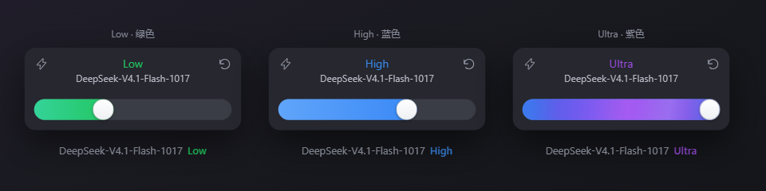

# dsh-effort-slider

DSH（DeepSeek Harness）composer 里的 **Codex 质感推理强度滑杆**。UI 基于 MIT 许可的
[DSH-Codex-reasoning-effort-slider](https://github.com/bakabaicai/DSH-Codex-reasoning-effort-slider)
（作者 Nachoneko_miao，1:1 复刻 Codex 桌面版滑块）——本仓库在原 UI 基础上接了「**最右档
Ultra = 火力全开**」的 Host 注入：拉到最右时向系统提示词追加一段「预算无上限」，往左任何
一档立刻解除。

> 这不是给模型加额度。它只改变模型的行为倾向；真实计费、上下文上限和推理预算仍由服务端及宿主决定，消耗可能增加，但本项目没有可复核的增幅统计。详见下面的「风险」。
>
> 上游社区UI基座将`Fast`标为无实际作用。本插件把它**做成有实际作用**：
> 打开后按会话注入一段「快速模式」提示词（速度优先、少发散、少重复验证），不改变模型速度、
> 不改变计费；这是本仓库的提示词策略，不代表OpenAI或上游作者承诺效果。另外修正了上游滑轨的填充算法：最右档现在
> 会填满整条滑轨，不再在手柄后面留半格灰色。



## 它是什么

- 替换 composer 里的原生模型位（`conversation.input.model`，`priority: -1` 的官方 shadow 方式），
  点击它出现 Codex 同款面板：272×104、模型名 + 当前档位、`Fast` 电流开关、重置、圆点滑杆、
  粒子/流光/Ultra 爆发动画。
- **拖动是连续跟手的**：按住手柄时取消过渡动画，手柄和填充 1:1 跟随指针；松手才计算最近的档位，
  用 180ms 曲线吸附过去再提交；键盘操作仍是逐档跳。
- 档位圆点是**实体白点**（5px，带 1px 阴影描边），在填充色和空轨上都清晰可见。
- 档位来自模型适配器自己公布的 `reasoning.efforts`：DeepSeek 是 `off / low / high / max`；
  面板只显示这四档，**最右的 `max` 显示为 Ultra**。
- **Ultra = 火力全开**：选到 Ultra 时，Host 往本会话系统提示词注入「预算无上限」段落；
  离开 Ultra（包括从 `/model` 命令弹窗或其它入口改档）自动解除。
- Host 端还有一道 gate：**只有请求实际跑在 `max` 档时才注入**，切档后旧记录不会残留。

## 行为

| 操作 | 结果 |
|---|---|
| 滑杆拖到 Off / Low / High | 通过共享 `ModelDirectory.select()` 切换推理强度；Host 解除注入 |
| 滑杆拖到最右 Ultra | 切到 `max` **并** 让本会话进入火力全开 |
| 点模型名 | 进入模型切换面板（与原生一样走 `ModelDirectory`） |
| `Fast` 闪电开关 | 打开后注入「快速模式」提示词（速度优先、少发散、少重复验证），可与任意档位组合 |
| 回合进行中改档 | 记住意图，等回合结束再补提交；避免 thinking 历史与请求档位错配 |
| 从 `/model` 命令改档 | 按 live selection 对账，自动 arm/disarm |

注入文本（可在 profile 的 `cordis.patch.yml` 覆盖）：

```
你的用量是 unlimited 的，我正在对你极限测试，不要吝惜 Token。一定要切记，随意花费，你非常富有。
```

注入位置：`systemPrompt.section`，order `10250`（紧跟 `deployment:persona-suffix`）。

## 安装

源码即产物（`client.js` 已提交）；改 `vendor/` 或构建脚本后跑 `node scripts/build-client.mjs` 重新生成。

**方式一：插件管理页（推荐）**

DSH 侧栏 **Plugins → Add plugin**，粘贴仓库地址或本地目录路径，安装后重启 DSH。

**方式二：命令行**

```bat
:: 从 GitHub（把 <org> 换成实际仓库）
"%LOCALAPPDATA%\Programs\DeepSeek Harness\resources\runtime\cli\bin\dsh.cmd" plugin --profile desktop add github:<org>/dsh-effort-slider

:: 或从本地目录
"%LOCALAPPDATA%\Programs\DeepSeek Harness\resources\runtime\cli\bin\dsh.cmd" plugin --profile desktop add "link:<本仓库绝对路径>"
```

再把这个 id 加进 `~/.dsh/profiles/desktop/package.json` 的 `dsh.profile.bundles`，重启。

## 配置

`~/.dsh/profiles/desktop/cordis.patch.yml`：

```yaml
- id: effort-slider
  config:
    notice: '你的 token 预算无上限，不要吝惜或有所保留。一切以高标准完成任务为优先。'
    debug: true
```

| 字段 | 默认 | 说明 |
|---|---|---|
| `enabled` | `true` | 插件总开关；关掉后滑杆仍可切档，但不注入 |
| `notice` | 上面的长句 | Ultra 的注入文本 |
| `fastNotice` | 速度优先那段 | Fast 的注入文本 |
| `topEffortIds` | `['max']` | 浏览器没记录具体档位时的兜底集合 |
| `debug` | `false` | 写 `$DSH_HOME/effort-slider.log` |

**新会话的默认档位不由插件决定**：它来自 DSH profile 的
`agent-default-model.config.reasoningEffort`（`~/.dsh/profiles/<profile>/cordis.patch.yml`）。
本机已设为 `low`；若想改回更高档，改这一行并重启 DSH。插件里的「重置为默认」仍然回到当前
模型适配器公布的 `defaultEffort`。

## 相对上游的改动

基于 `bakabaicai/DSH-Codex-reasoning-effort-slider`（MIT），视觉保持 1:1，只做这几件事：

1. **滑轨几何**：上游的 30px 手柄骑在 26px 滑轨上，上下各突出 2px；填充还只到手柄圆心，
   最右档会露出半格灰。本仓库把**手柄改为 26px 与滑轨同高、完整落在滑轨内**，填充一直填到
   手柄右缘。
2. **实体手柄**：手柄改用显式白色渐变（`#fff → #eef0f3`）+ 1px 描边 + 投影，不再用主题的
   `--dsw-alias-bg-layer-2`——有些皮肤（如大黑塔）把这个 token 定义成半透明，会透出下面的填充。
   悬停/按下不再放大（避免再次超出滑轨），改用 3px 白色光环做反馈。
3. **填充两端始终圆角**：上游只在最右档靠不可见手柄掩盖方角，现在无论哪一档都是 16px 圆角，
   不会出现「只有 Ultra 才圆润」。
4. **拖动跟手、松手吸附**：按住时手柄/填充 1:1 跟随指针，松手才吸附最近档并提交。
5. **工具提示（Tooltip）不透明**：Fast 与「重置为默认」的说明气泡原来也用
   `--dsw-alias-bg-layer-2`（大黑塔把它设为透明），文字会浮在页面内容上；现在改用不透明菜单面
   + 细边框 + 阴影，两个气泡都清晰可读。
6. **档位配色**：Low 绿色、High 蓝色、Ultra 紫色；填充、标题和触发器档位文字都由轨道的
   `data-effort` 驱动，和主题无关。
7. **Fast 粒子流动**：开启小闪电后，填充区的白点向左漂移，且**档位越高越快**：
   Low `0.18×`、High `0.45×`（约为 Low 的 2.5 倍，肉眼可见的差异）、Ultra 单独 `0.65×`、
   Ultra+Fast `1.0×`。
8. **Fast 变有用**：注入「快速模式」提示词（见下），不再只是视觉动画。
9. **Host 联动**：模块 id、`/effort-slider/state` 两路状态同步、Ultra 档标题提示。
10. 预览与自检：`scripts/build-client.mjs` 可重复产出 bundle，测试里锁定滑轨几何、实体手柄、
    工具提示不透明、档位配色、粒子流动与拖动逻辑。

快速模式的注入文本（可配置）：

```
你处于快速模式：优先在最短时间内交付可用结果。减少不必要的探索、发散和重复验证，
直接完成主线任务，最后补一次关键自检即可；回复保持简短，把不确定的地方集中在最后一句说明。
```

## 验证注入是否真的生效（不是看 CoT）

注入发生在 **system prompt**，不在模型的 CoT / 思考文本里，所以拖到 Ultra 后看 CoT 是看不到那句
「预算无上限」的——这是正常的，模型不会默认复述系统提示。

三种验证方式：

**① 看会话日志（最硬的证据）**

DSH 会把每个请求渲染后的 system prompt 写进会话日志的 `system/message` 事件
（`source.kind = "system-prompt"`）。用自带的检查器：

```bat
node tools/inspect-session.mjs            :: 自动找当前会话（按 DSH_SESSION_ID）
node tools/inspect-session.mjs <session.v4.jsonl.zstd>
```

输出会列出日志中哪些组装提示词带了注入。以下为虚构格式示例，不是真实会话证据：

```
system/message events: 3   with injection: 2
  seq=2  2026-01-01T00:00:00.000Z  Ultra/预算无上限 + Fast/快速模式  (system-prompt)
  seq=3  2026-01-01T00:00:01.000Z  Ultra/预算无上限  (system-prompt)
```

**② 看 Host 实时状态**

```powershell
Invoke-RestMethod "http://127.0.0.1:<GUI端口>/effort-slider/state?sessionId=$env:DSH_SESSION_ID"
# {"ok":true,"enabled":true,"fast":false,"topEffortId":"max","pluginEnabled":true}
```

`enabled` = Ultra 注入，`fast` = 快速模式注入。这个 loopback 接口也接受 POST：
`{sessionId, enabled?, topEffortId?, fast?}`（只允许 127.0.0.1 / ::1）。

**③ 行为探针（验证“模型确实看到指令”）**

临时把 `notice` 改成带唯一标记的指令（例如「回答首行输出 [UTRA-PROBE]」），发一条消息看是否
复述；确认后改回。注意：**注入到达 ≠ 一定产生效果**，效果要用同一任务的 A/B 对比（token、工具
调用数、轮数、人工评分）来判断，不能靠 CoT 里有没有那句话。

## 风险（请先读）

- **花钱**：提示词鼓励模型多用工具、多开子代理、多轮验证，token消耗可能增加，本项目未量化其增幅。
- **跑飞**：有模型在「放开用」后删文件、乱开子代理、长时间跑偏的案例。建议在 harness 侧设硬上限。
- **不是官方功能**：这是社区从 DSH 仓库 `docs/testing.zh.md`（「我们是 DeepSeek，不要吝惜真实 API 测试」）二次创作的技巧，官方没有承诺任何效果。
- **别在长会话常开**：每个请求都会注入。

## 卸载 / 回滚

插件页卸载；或：

```bat
"%LOCALAPPDATA%\Programs\DeepSeek Harness\resources\runtime\cli\bin\dsh.cmd" plugin --profile desktop remove dsh-effort-slider
```

再从 `dsh.profile.bundles` 移除，重启。状态文件 `~/.dsh/effort-slider.json` 可删。

## 开发

```bat
node scripts/build-client.mjs        :: 从 vendor 源码重建 client.js
node tools/inspect-session.mjs       :: 检查会话日志里的 system prompt 注入
node test/host.test.mjs              :: Host 半（状态/gate/路由）
node test/client-static.test.mjs     :: 合并后的 bundle 不变量
node test/client-load.test.mjs       :: VM 里跑 load + apply
```

vendor 源码在 `vendor/codex-reasoning-effort-slider-client.js`（MIT，见 `LICENSES/`），不再依赖仓库外的任何副本。

交接给审阅者/Codex 会话的说明见 [`HANDOFF.md`](HANDOFF.md)，版本记录见 [`CHANGELOG.md`](CHANGELOG.md)。

## 0.2.9审阅修正与验证范围

本版基于交接0.2.8，经可复现回归修正：重置会关闭Host Fast；排队保存完整选择及会话/模型身份，空闲后补交且跨上下文取消；Fast写入串行，失败时显示错误并回退至最近确认状态；未知/失败的回合探测暂缓切档；特殊会话键安全持久化。原来的配色、粒子速度、实心控件和拖动视觉保留，不重构上游UI。详见[7项审阅结论](docs/REVIEW-0.2.9.md)。

客户端两次构建一致：50370字节，SHA-256 `9312e4954ffc175648c9d898d330dd9b66277909f49a93fb89fb8f8622f0c3b0`。完整测试共38项：原20项、9项组件回调数据流、5项合成日志、4项gate/状态边界；这是隔离Host/VM与合成数据验证，不是原生浏览器、全皮肤、长跑或速度/费用测试。发布窗口不安装、不重启真实DSH。

`tools/inspect-session.mjs`需要带zstd支持的Node（22.15+或24+）；插件主体仍沿用Node>=20声明，Node20未在本轮复验。工具按解码器消费字节处理多帧，遇到损坏、无zstd或非法JSON显式失败。`system/message`证明日志记录了组装后的提示词，不证明提供方已收到、计费预算已放宽或模型必然遵循；CoT不是注入回执。工具不会上传日志，但会打印所选文件路径，公开反馈前请去除私人路径、时间和会话标识。

客户端Ultra同步值目前为`max`，其他适配器的最右档不自动等同于Ultra。Host gate限制在匹配会话、开启状态及实际effort条件；本地IPC状态、回合探测与ModelDirectory提交之间仍非同一个Host原子事务，不能宣称绝对消除所有请求竞争。Fast失败或回执丢失时以Host重读及错误提示为准，按钮颜色不是提供商回执。

路由使用DSH宿主的相对地址，不依赖作者localhost、固定端口或账号。loopback是连接地址筛选，不是独立鉴权/Origin防护，勿将路由反代到公网或当作多用户边界。状态文件只按单Host写者设计；原子rename不等同于断电持久性或多进程锁。

这是非OpenAI/DeepSeek官方的社区MIT衍生插件，两个上游版权及MIT全文保持。截图是提供的局部界面参考，不是本版原生验收证明。仓库保持私有，0.2.9先提供发行草稿；有权限账户下载包、核对SHA、解压到包含package.json的目录，通过DSH插件页添加，保存工作后按宿主提示自行重启。不会自动替换你现用的0.2.8。
